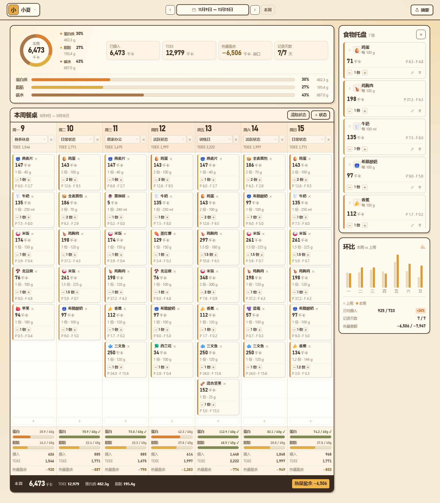
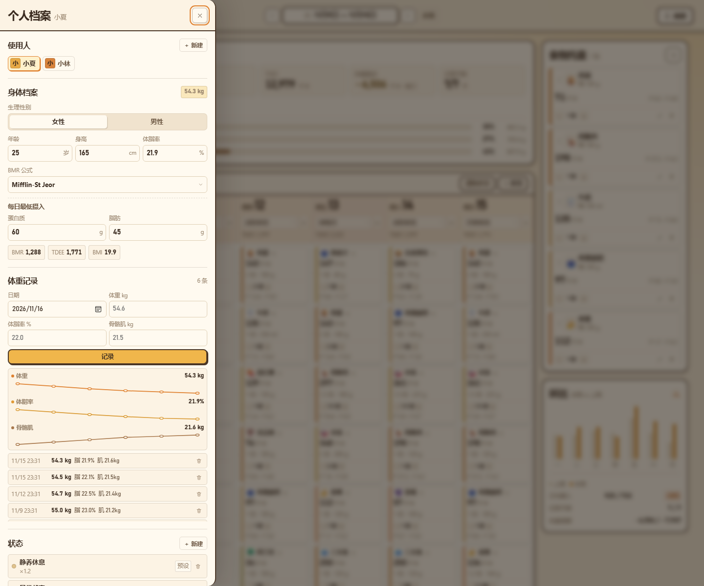
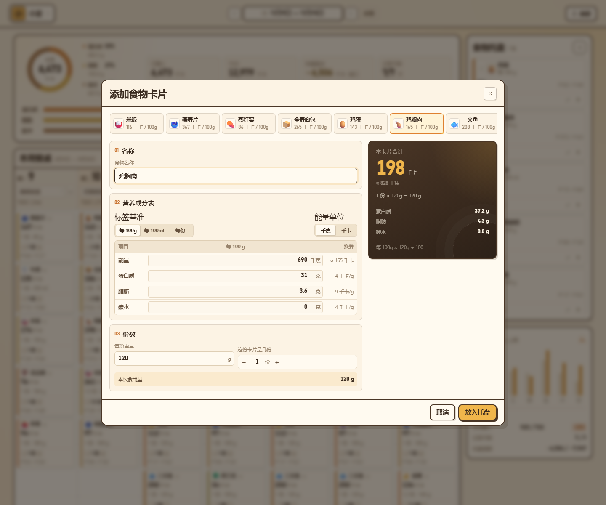
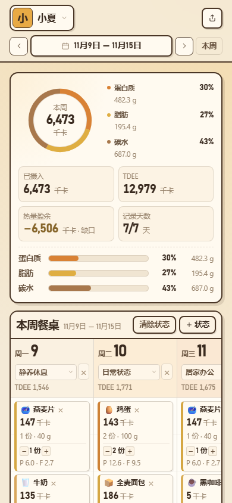

# 食刻 · 本周餐桌

一个本地运行的每周饮食规划与热量核算网页：右侧食物托盘、中间七天饮食表、顶部营养环、左上角个人档案，以及右侧周环比图。



## 使用

双击 `index.html` 即可，无需安装、无需构建、无第三方依赖。

推荐使用较新的 Chrome、Edge、Firefox 或 Safari。

## 界面结构

### 左上角：个人档案

点击左上角的头像/名字打开左侧档案抽屉：

- **使用人**：新建、切换使用人；每位使用人的身体数据、体重记录、食物托盘和饮食表彼此独立。
- **身体档案**：性别、年龄、身高、体脂率、BMR 公式，以及每日最低蛋白质、脂肪摄入标准；当前体重自动取最新一条体重记录。
- **体重记录**：可记录体重、体脂率和骨骼肌量，记录按录入时间倒序排列；图表分别绘制体重、体脂率、骨骼肌量三条趋势线。当前 BMR 使用最新一次记录的体重，Katch-McArdle 会使用最新记录的体脂率。
- **状态**：预设状态和自定义状态都在这里管理。预设状态可以直接删除，自定义状态可以编辑或删除；至少会保留一个状态。



预设状态：

| 状态 | 倍率 |
| --- | ---: |
| 静养休息 | 1.20 |
| 日常状态 | 1.375 |
| 活跃状态 | 1.55 |
| 训练日 | 1.725 |
| 高负荷日 | 1.90 |

### 本周表

- 横轴为周一至周日，每天顶部通过下拉框选择当天状态。
- 表格顶部「＋ 状态」直接打开个人档案中的状态管理，可新增状态。
- 表格顶部「清除状态」把本周所有日期恢复为默认状态；每天状态右侧的 `×` 只清除当天的状态。
- 右侧食物托盘中的卡片直接拖到任意日期列即可加入。桌面端可按住卡片任意空白处拖动，触屏请拖左上角手柄；拖到屏幕边缘会自动滚动。
- 每张食物卡片有自己的份数，例如 1 份或 2 份；拖入日期后仍可用卡片底部的 `− / +` 单独调整这一天的份数。
- 每天底部显示：蛋白质和脂肪对每日最低标准的横向对比条、摄入、TDEE、热量盈余/缺口。达到最低标准时会显示 ✓ 并变绿。
- 整张表最下方显示本周合计、TDEE、蛋白质、脂肪和总热量差额。

### 顶部营养环

用环状图显示本周蛋白质、脂肪、碳水化合物的供能比例，中心显示本周总摄入，旁边列出百分比和克数，并显示已摄入、TDEE、热量盈余、记录天数。环状图下方另有蛋白质、脂肪、碳水三条横向条状图，同时标出百分比和克数。

### 右侧食物托盘

- 每位使用人都有自己的托盘。
- 卡片保存的是「一份食物」的营养数据和份数，可被重复拖入不同日期。
- 卡片内容可编辑、可删除；删除卡片不会删除已经放入日期的记录。
- 支持按包装营养成分表录入：每 100g / 每 100ml / 每份，千焦 / 千卡切换，自动换算。



### 右侧环比

当前周与上一周：

- 一周七天的摄入双柱对比图。
- 本周 / 上周日均摄入、记录天数、热量差额。

### 跨周查看

顶部左右箭头切换周，中间日期范围可点击选择日期，「本周」返回当前周。每日状态和食物记录按日期保存。

## 计算公式

### BMR

- **Mifflin-St Jeor**
  - 男性：`10 × 体重kg + 6.25 × 身高cm − 5 × 年龄 + 5`
  - 女性：`10 × 体重kg + 6.25 × 身高cm − 5 × 年龄 − 161`
- **Katch-McArdle**：`370 + 21.6 × 去脂体重kg`
- **Harris-Benedict（修订版）**
  - 男性：`88.362 + 13.397 × 体重 + 4.799 × 身高 − 5.677 × 年龄`
  - 女性：`447.593 + 9.247 × 体重 + 3.098 × 身高 − 4.330 × 年龄`

Katch-McArdle 需要 3–70% 的体脂率，否则自动回退到 Mifflin。

### TDEE 与差额

```text
TDEE = BMR × 当日状态倍率
热量盈余 = 当天已摄入 − 当天 TDEE

每日蛋白质达成率 = 当日蛋白质 ÷ 每日最低蛋白质
每日脂肪达成率   = 当日脂肪 ÷ 每日最低脂肪
```

每天的状态可以不同，因此每天 TDEE 也可以不同。

### 食物折算

```text
按 100g / 100ml 标签：
  实际食用量 = 每份重量 × 份数
  折算系数   = 实际食用量 ÷ 100
  项目总量   = 标签值 × 折算系数

按每份标签：
  项目总量 = 每份标签值 × 份数

千卡 = 千焦 ÷ 4.184
```

## 数据

- 全部数据保存在浏览器 `localStorage`，不上传服务器。
- 第三版存储键：`shike-calorie-ledger-v3`。
- 会自动读取第二版 `shike-calorie-ledger-v2` 或第一版数据并迁移：原身体档案、每日食物和自定义状态会保留，原体重会生成第一条体重记录。
- 清理站点数据会同时删除所有使用人、体重记录、托盘和饮食记录。

## 文件

```text
Heat-Calculation/
├─ index.html              页面结构
├─ styles.css              视觉与响应式布局
├─ app.js                  计算、托盘拖拽、周表、档案与存储
├─ preview.png             本周餐桌主界面
├─ preview-profile.png     个人档案与体重记录
├─ preview-status.png      状态新增
├─ preview-dialog.png      食物卡片录入
├─ preview-mobile.png      移动端
└─ README.md
```

## 说明

- 首次打开会创建一个示例使用人，并放入 6 张常用食物卡片作为托盘起点；可直接编辑或删除。
- 计算结果是日常估算，不构成医疗或营养建议。
- 移动端周表支持横向滚动；食物卡片从左上角手柄拖入日期列，拖到屏幕边缘会自动滚动页面。


